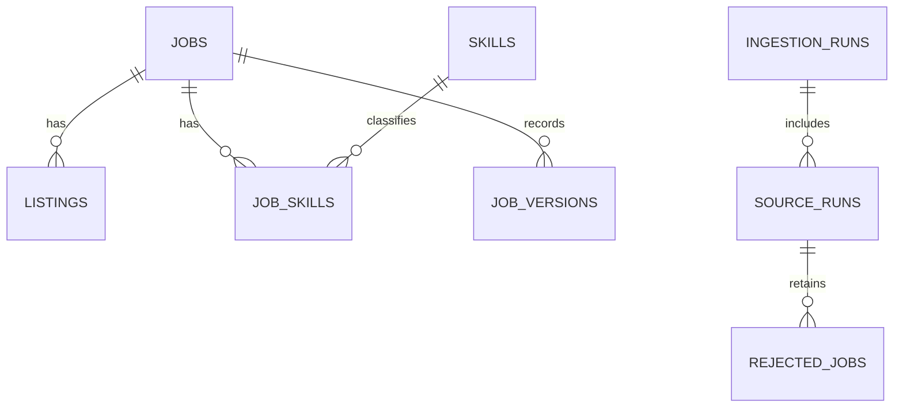

# JobHarvest

A working daily job collector, SQLite database and local dashboard. Built with Python's standard library; no third-party packages, API keys or paid services are needed for the enabled feeds. Requires Python 3.10 or later.

**Scope:** all roles and locations available from the enabled sources. **Schedule:** midnight India time (00:00 Asia/Kolkata).

## Open and use

1. Double-click **start-dashboard.cmd**. Keep its window open while using the dashboard.
2. Open **http://127.0.0.1:8766**.
3. Search or filter the stored jobs. Select a listing to read the description and follow its source link. Export the current filtered results using **Export CSV**.
4. **Collect jobs now** starts a background collection. Sources inside their polling interval are skipped. Check **Collection history** for source-level results and warnings.

The database is **data/jobs.sqlite3**. Collection logs are **data/jobharvest.log**, with rotation. It already contains the first live collection. The included **scripts/runtime.json** points to the Python executable used on this computer. On another computer, change that path or pass `-PythonPath` to the launcher.

## Add company career sites

Open **Company career sites** in the dashboard. Enter up to 25 companies per batch, one per line:

```text
Google | https://www.google.com/about/careers/applications/jobs/results
Meta | https://www.metacareers.com/jobsearch/
Your Company | https://company.example/careers
```

Select **Find boards & collect jobs**. Discovery recognizes Google Careers, Meta Careers and hosted Greenhouse, Lever (global and EU), and Ashby boards. It also recognizes public pages that contain standard `schema.org/JobPosting` metadata, including JSON-LD graphs and arrays. For a company's own website it checks the supplied page, embedded board URLs, redirects, and up to three same-host career links. It respects robots rules and refuses private-network URLs. If a site requires JavaScript, login, a challenge, Workday or another unsupported job system, the result explains that another connector is needed. It does not discover every company on the internet.

New boards are saved in **config.json** and included in the existing midnight collection task automatically. Already configured boards are not duplicated or re-enabled if disabled. Full descriptions, original links, skill extraction and duplicate handling use the existing collection pipeline. **Add 10 starter companies** registers Stripe, Airbnb, Cloudflare, Razorpay, Figma, Notion, Ramp, Linear, Palantir and Spotify; individual feeds may change or become unavailable.

**Google coverage:** Google's public job sitemap discovers job links across its inventory. Each run imports the first search page and reads up to `collection.max_pages` additional sitemap entries (30 by default), cycling through the IDs from the saved database cursor. Descriptions include qualifications, responsibilities and job overview. Its robots policy blocks search pagination, so the collector does not request paginated search URLs. Google coverage grows in batches; the first run does not import all Google openings. Sitemap links can be stale; inaccessible details are reported and revisited in a later cycle. Google snapshots remain partial, and automatic closure detection is disabled. Embedded undocumented timestamps are not presented as publication dates.

**Meta coverage:** Add `Meta | https://www.metacareers.com/jobsearch/`. The connector reads Meta's public job sitemap and up to `collection.max_pages` individual job pages per collection (30 by default). It persists a cursor and cycles through job IDs on later runs. It stores overview, responsibilities, separate minimum/preferred qualifications, locations, publication dates and published compensation when provided. It reads only public HTML; no internal GraphQL endpoint, login, or cursor search pagination is used. Its partial snapshots do not close saved jobs. The sitemap can include inaccessible or stale pages, and a single batch does not cover all Meta openings.

**Other structured career pages:** A supplied page with valid JobPosting metadata can be saved as a `structured` source. It imports records from that page, not an assumed complete company inventory. Separate postings must have separate source URLs to prevent accidental merging. Missing or invalid metadata produces a clear error and preserves saved jobs. Partial structured snapshots never close jobs automatically.

**Collection visibility:** Each saved site shows its latest actual collection, jobs fetched/new, and warnings. Cooldown skips do not replace the last actual collection status. Live progress identifies the company and Meta batch position. Public-page requests use bounded timeouts and one retry for transient server errors; 401/403 and 429 pause collection instead of repeatedly requesting a denied/rate-limited site. A failed source does not stop other companies.

Command-line discovery uses the same function:

```powershell
python -m jobharvest add-sites --starter
python -m jobharvest add-sites --file company-sites.txt
python -m jobharvest collect
```

`company-sites.txt` uses the line format above. CLI discovery saves boards; run `collect` to import them. The dashboard combines both steps in a background task and shows per-site results. Existing polling intervals still apply, so repeated clicks do not force another immediate fetch.

## Daily automation on this computer

The **JobHarvest-Daily** Windows task is installed and enabled. It runs the collector independently of the dashboard at **00:00 India time**, while this Windows user is signed in. Windows attempts a missed start when the task can run. The PC must be online; this is local automation, not a cloud service. Only the latest missed daily slot is collected, not a replay of historical days.

Reinstall the task after moving the project or changing the schedule:

```powershell
powershell.exe -NoProfile -ExecutionPolicy Bypass -File .\scripts\install-schedule.ps1
```

Remove the scheduled task while preserving the database:

```powershell
powershell.exe -NoProfile -ExecutionPolicy Bypass -File .\scripts\remove-schedule.ps1
```

The task installer supports India time and converts the trigger to an explicit UTC boundary. To use a different timezone, use Python's persistent scheduler; Windows may require the `tzdata` package for other IANA zones. The India timezone fallback is built in.

```powershell
.\scripts\run.ps1 -Command schedule
# Or keep the dashboard and scheduler in one process:
.\scripts\run.ps1 -Command serve -Scheduler
```

Both approaches require a running process. A database file lock prevents overlapping runs if more than one scheduler is started. Scheduled attempts are recorded once per daily slot, including partial or failed attempts. Manual retries become available after source cooldowns.

## Configuration and sources

Edit **config.json**. Changes to sources and collection filters are picked up by the next collection. Reinstall the Windows task after a schedule change. Restart the dashboard after changing the database path.

| Source | Initially enabled | Coverage / setup |
| --- | --- | --- |
| Remotive | Yes | Public remote-job feed; source attribution and original Remotive links are preserved. |
| Arbeitnow | Yes | Public feed, mostly European jobs; all available pages up to the configured cap. |
| Greenhouse | No | Add an employer's board token and company name. |
| Lever | No | Add an employer's site name, company name and global/EU region. |
| Ashby | Company boards added | Public job postings with descriptions, locations and compensation where supplied. Unlisted postings are excluded. |
| Google Careers | Yes | Public search HTML and sitemap; rotating batches of full descriptions. |
| Meta Careers | Yes | Public sitemap and structured job pages; rotating batches with a saved cursor. |
| Structured career page | When added | Public JobPosting metadata on the supplied page; partial inventory. |

The Greenhouse and Lever rows describe the original disabled examples. Additional enabled company boards are now listed in **config.json** and the dashboard.

Greenhouse: a careers URL like `https://boards.greenhouse.io/example` usually has board token `example`. Lever: `https://jobs.lever.co/example` usually has site name `example`. Verify the actual company's board identifier, replace the disabled example's `board` and `company`, set `enabled` to `true`, and use a unique `name`. The connector does not discover employers automatically.

To restrict future collection, update `filters`, for example:

```json
{"roles": ["developer", "engineer"], "locations": ["India", "Worldwide"], "remote_only": true}
```

Values within a field use OR matching; fields combine with AND. Role and location comparisons are case-insensitive substring matches. A source's geographical restriction is not proof of eligibility. Previously stored jobs remain in the database; use dashboard filters to narrow them. Closure detection is disabled during filtered collections.

## Stored fields

Role/title, domain, full plain-text JD, skills, company name, location, country when supplied, experience level, minimum/maximum years when unambiguous, evidence for years mentioned, workplace type, employment type, salary text, publication date, source URLs and IDs, first/last observation dates, active status and update history.

Fields from sources are kept separately from inferred flags. Skill extraction uses a configurable dictionary in **jobharvest/normalize.py**. A skill mention may be optional, part of a company description or one of several requirements; verify the JD. Domains describe the role or the source's category, not a verified company industry. Experience-level inference primarily uses English title keywords. Non-English descriptions are preserved; extraction coverage is limited. Salary remains source text rather than an invented currency or range. A Greenhouse update date is not misrepresented as a publication date.

Descriptions are converted to text and displayed safely. Current source payloads are stored in `listings.raw_json`. Normalized changes are retained in `job_versions`; future rejected records and their reasons are saved in `rejected_jobs`.

## Duplicate handling and inactive jobs

- Repeat collection uses `(source, external_id)` to update the existing source listing.
- Across sources, matching normalized URLs or exact company/title/location/description fingerprints share one job and retain all source links. Similar jobs with materially different descriptions may remain separate, avoiding broad merges of different openings.
- Job history changes only when normalized content changes. Original observation dates remain intact.
- A listing becomes inactive after three complete snapshots in which it is absent. The canonical job stays active if any of its source listings is active. A reappearing listing is reopened.
- Failed, truncated, malformed or filtered snapshots do not close listings. This is a conservative availability estimate; confirm on the original board.

## Commands

Run from this project folder, using your Python executable:

```powershell
python -m jobharvest init
python -m jobharvest collect
python -m jobharvest due
python -m jobharvest serve --port 8766
python -m jobharvest search --q developer --location India --skill Python
python -m jobharvest status
python -m jobharvest export --output data/jobs.csv
python -m jobharvest backup --output data/jobs-backup.sqlite3
python -m unittest discover -s tests -v
```

On this computer, the launcher selects the bundled runtime automatically:

```powershell
.\scripts\run.ps1 -Command collect
.\scripts\run.ps1 -Command status
.\scripts\run.ps1 -Command test
```

Use `python -m jobharvest --config path/to/config.json collect` for an alternate configuration. Paths in a configuration are relative to that file. Export and backup paths are also relative to the configuration folder unless absolute. CLI exit codes: 0 for success/skipped/not due, 1 for partial/failed/invalid configuration, and 2 for an already-running collector. A partial result can contain successfully saved jobs; inspect source runs.

## Local JSON API

| Endpoint | Purpose |
| --- | --- |
| `GET /api/health` | Process health |
| `GET /api/stats` | Counts, configured sources, schedule and collector status |
| `GET /api/jobs` | Search: q, location, skill, company, domain, level, source, remote, active, limit, offset |
| `GET /api/jobs/{id}` | Full JD, skill inference flags, source links and metadata |
| `GET /api/runs` | Latest 20 collection runs and source results |
| `GET /api/export.csv` | Export all results matching the same search filters |
| `POST /api/collect` | Start collection; send the `csrf_token` from stats as `X-JobHarvest-Token` |
| `POST /api/company-sites` | Discover and save company boards, then collect in the background; JSON body `{"sites":"Company name &#124; https://career-url"}` or `{"starter":true}`; requires the same collection token |

Job searches default to active listings and 30 results; maximum page size is 100. `active=all` includes inactive jobs; `remote=true` requires a remote workplace. The dashboard uses 25 jobs per page. CSV export includes the full descriptions and prevents spreadsheet formula interpretation for risky cell prefixes.

The server binds to 127.0.0.1 only. Host checks and collection tokens protect local actions. No external scripts, analytics or accounts are used. This is a personal local service; authentication and a production server would be necessary before shared deployment.

## Database structure



SQLite uses WAL mode, foreign keys, parameterized queries and indexes for lookup. Source imports are transactional. An unavailable feed does not stop the other feeds. An OS file lock prevents simultaneous imports; abandoned runs are marked interrupted when the next collection starts. `state` stores schedule slots, polling timestamps and Remotive's request budget. Database backups use SQLite's backup API so committed data is consistent.

## Source documentation and access rules

- [Remotive public API](https://github.com/remotive-com/remote-jobs-api): preserve attribution and links, do not syndicate its jobs to third-party job boards, and do not gate its listings behind email collection. Its public data is delayed by 24 hours. JobHarvest enforces at least six hours between collection attempts and at most four HTTP requests in a rolling 24 hours, including retries.
- [Arbeitnow API](https://www.arbeitnow.com/blog/job-board-api): public feed without an API key. Default polling interval is one hour; the configured daily schedule requests it once per day.
- [Greenhouse Job Board API](https://docs.greenhouse.io/job-board.html): public GET endpoints and `content=true` for descriptions.
- [Lever Postings API](https://github.com/lever/postings-api): public JSON postings and pagination, including descriptions and requirement lists.
- [Ashby public Job Postings API](https://developers.ashbyhq.com/docs/public-job-posting-api): public board listings and optional compensation; unlisted postings are excluded.
- [Google Careers](https://www.google.com/about/careers/applications/jobs/results), [public job sitemap](https://www.google.com/about/careers/applications/jobs/sitemap.xml), and [robots rules](https://www.google.com/robots.txt): public pages with bounded requests; blocked search pagination is not used. This HTML adapter may need updating when Google's embedded page structure changes.
- [Meta Careers](https://www.metacareers.com/jobsearch/), [public job sitemap](https://www.metacareers.com/jobsearch/sitemap.xml), and [robots rules](https://www.metacareers.com/robots.txt): public sitemap and individual job pages; cursor search pagination and disallowed URLs are not requested. Site access policies still apply. The connector pauses if public access is denied.
- [schema.org JobPosting](https://schema.org/JobPosting): public structured job metadata used by the reusable career-page parser.

This version uses the listed feeds, Google's and Meta's public careers HTML, and supplied pages with public structured job metadata. LinkedIn, Indeed and other job systems are not implemented. Additional systems need a source-specific connector and an allowed access method. Public feeds provide a useful starting dataset, not worldwide job completeness.

## Troubleshooting

- **Dashboard cannot open:** start the dashboard launcher. The updated dashboard uses port 8766. If port 8766 is busy, use `scripts/run.ps1 -Command serve -Port 8767` and open that port.
- **Collection is skipped:** the feed is in cooldown or the scheduled slot was already attempted. Jobs remain searchable.
- **Partial collection:** inspect Collection history and the log. Valid jobs are saved; malformed records are rejected and closure detection is suspended for that source. The first live Arbeitnow collection skipped five incomplete records.
- **HTTP 429 / timeouts:** public career pages pause on denied access or rate limits; transient server errors receive one bounded retry. API feeds retain their existing bounded retry policies. Polling timestamps are recorded before requests so repeated failures cannot hammer a source. Retry later after the cooldown.
- **Page cap reached:** jobs fetched so far are retained, run status is partial and closure detection is disabled. Increase `max_pages` cautiously, keeping the delay.
- **Daily task does not run:** check Windows Task Scheduler for JobHarvest-Daily, its last result, this user's signed-in session, the runtime path and internet access. Reinstall if the project was moved.

See **PLAN.md** for the implemented plan and boundaries; **VALIDATION.md** records the checks performed on the delivered build.
